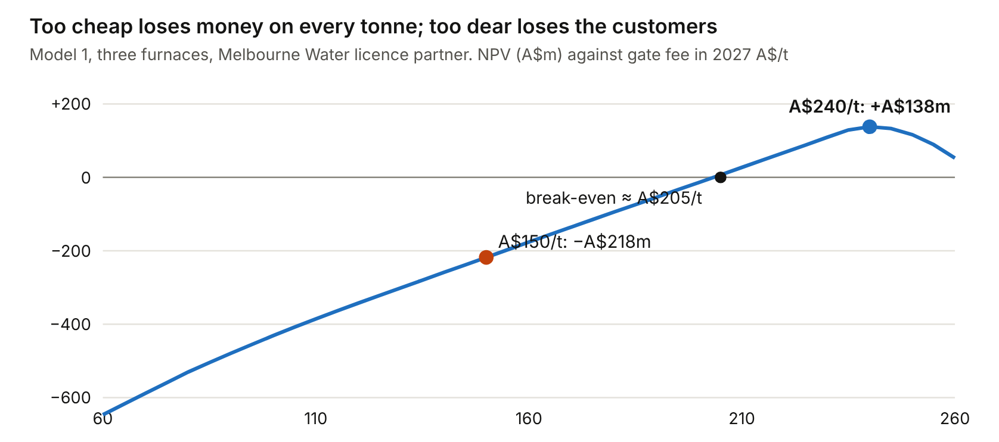

# Chengdu Environment Group in Australia: market-entry research · 成都环境集团澳洲市场研究

🏆 **NexStar Excellence Award, City of Melbourne** · NexStar 2026 Melbourne–Chengdu Sprint, team CDEG–A
**Live site 网站 → [cdeg.ksmarsh.net](https://cdeg.ksmarsh.net)** (bilingual EN/中文)

## Executive summary
- **Answer:** a two-speed, asset-light entry. CDEG should start now in businesses that need no waste-to-energy (WtE) licence and no equity (sludge and biosolids services, food-waste decontamination, smart water meters for regional utilities), and lead its WtE play with operations and maintenance for existing licence holders.
- **Why:** Victoria's 2.5 Mt/yr thermal WtE cap is already 94% allocated, but none of the licensed plants is built or has named an operator. Their operation is worth about A$176m a year, or A$45–91m after political and self-operation risk.
- **So what:** CDEG's edge is operating experience, not licences. Three licence holders (Cleanaway, HiQ, Melbourne Water) are big enough for its two-line plants.

## Problem
Chengdu Environment Group, a Chinese waste and water company, wants to enter Australia. The team was asked where it can compete, what approvals each business line needs, and whether the economics work.

## Approach
- Desk research across 130+ cited sources (EPA Victoria licences, parliamentary inquiry submissions, utility tenders, company filings). Model inputs live in `data/assumptions.csv`, each with a source ID.
- Business-line analysis (waste-to-energy, sludge, organics, meters, chemicals) and a compliance map of the approvals each line needs.
- **Interactive models (Observable JS):** a WtE plant payback/NPV model for a Latrobe Valley site, an O&M contract model, a meter-distributor model and a council map, all driven by one assumptions table.

## Key findings

- In the plant model, an owner needs a gate fee of about **A$205/t** (2027 dollars) to break even, and value peaks near **A$240/t**. Metro landfill costs about A$272/t, which sets the ceiling.
- Every 5 points of plant availability is worth about **A$40–45m** to an owner. That's the lever an experienced operator controls.
- Political risk is as large as community risk: 86% of 537 inquiry submissions raise health concerns.
- Chinese entrants have done best as service businesses with local partners (e.g. BEWG's TRILITY). Control of critical networks has been refused.

## Tools
Quarto (bilingual website, custom language toggle) · Observable JS (interactive models) · D3 · KaTeX · GitHub Actions → Aliyun OSS (Hong Kong) → Cloudflare. The site is fully static with no external CDNs, so it loads inside mainland China.

## Repository contents
```
report/       introduction, market context, opportunity, customers, competitors, go-to-market
part-a/       business models, one page per line
part-b/       compliance and approvals
models/       interactive models (Observable JS)
appendix/     sources, assumptions, glossary
data/         assumptions.csv, sources.csv: the single source of numbers
assets/       language toggle, styles, vendored JS
```

## Limitations
- This is a student consulting project based on public sources. Figures marked "to verify" on the site aren't final.
- Model outputs are illustrative and depend on capex, price and landfill-levy assumptions, which swing value more than operations do.

## Team
Kai Marsh · Christine (Kuntong) Jiang · Janeika Jeyakanthan. Section authorship is shown on each page of the site.

---

Full report available on request.

## Licence
Code (the language toggle, styles, Observable JS models and build configuration) is released under the [MIT License](LICENSE). The report text, figures and data compilations are © 2026 Kai Marsh, Christine (Kuntong) Jiang and Janeika Jeyakanthan (NexStar 2026 CDEG–A team), all rights reserved. Cited third-party material remains with its owners. Vendored libraries in `assets/vendor/` (D3, Observable Inputs, htl, KaTeX) are distributed under their own licences.
